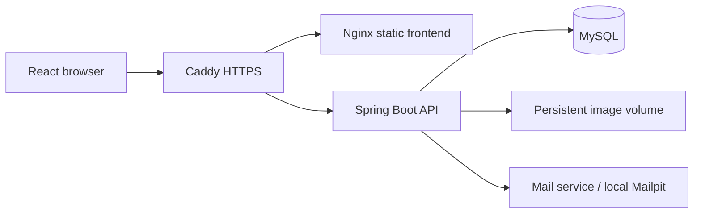

# Architecture, catalogue search and troubleshooting

This document describes the implementation in this repository. Local deployment
and recovery drills have been verified; they do not establish a public cloud deployment.

## System boundaries



The production stack is in `deploy/compose.yaml`. The gateway removes the
`/api` prefix before forwarding API requests. MySQL, backend and management ports
are not published to the host. The root Compose stack is for local development.
Code entry points: `SecurityConfig`, `JwtAuthenticationFilter`,
`CatalogController`, `CatalogService`, `CheckoutController` and `CheckoutService`.

## JWT authentication and authorization

1. Login verifies a username and BCrypt password hash. `JwtService` signs a JWT
   containing the username, user ID, role and expiration.
2. The frontend sends `Authorization: Bearer <token>`.
   `JwtAuthenticationFilter` verifies the signature and expiration and establishes
   the Spring Security identity.
3. `SecurityConfig` restricts administrator write endpoints. Checkout endpoints
   also use `@PreAuthorize` role checks. Product browsing permits anonymous access.
4. `POST /checkout` obtains the buyer from server-side Authentication.
   `GET /checkout/me` queries only that buyer's orders. A request-supplied username
   cannot change order ownership.
5. Invalid tokens do not establish an authenticated identity. Protected endpoints
   subsequently reject the request. Roles reflect the signed token's claims:
   role changes do not immediately revoke existing tokens, and there is no
   centralized token revocation list.

Password recovery uses expiring, single-use email tokens and database-backed
rate limits. User response DTOs omit password hashes. Local Mailpit verifies the
mail flow; public delivery still needs a configured SMTP service.

## Cart and order model

`Cart` stores the authenticated username, product ID, quantity and display
snapshots such as name, price and picture. Legacy cart rows without a product ID
retain a name-based fallback until updated. Cart prices are display estimates:
checkout reloads current product prices, availability and quantities from MySQL.

`Checkout` stores the buyer, order/payment status, decimal subtotal, shipping
and total, idempotency key, request fingerprint and a `productsJson` snapshot.
Order lines remain independent of later catalogue changes. These are scalar
fields and snapshots rather than a normalized JPA order-line relationship.

Successful checkout is followed by frontend requests to delete purchased cart
rows. Cart cleanup is outside the order transaction; a failed cleanup can leave
old cart rows even though the order succeeded. Retrying the same order request
with its original idempotency key does not deduct stock again.
See [checkout behavior](checkout.md) for the request contract and upgrade notes.

## Catalogue query contract

The shop uses `GET /product/search`, exposed as `/api/product/search` in the
production stack. `GET /product` remains for administrator pages and older
consumers; the shop no longer downloads the entire catalogue.

| Parameter | Default / limits | Meaning |
| --- | --- | --- |
| q | Empty; at most 200 characters | Case-insensitive contains match across name, main category, subcategory, brand, color and description |
| mc / sc / br | Empty or All means unrestricted | Exact main category, subcategory and brand filters |
| min / max | Independently optional | Inclusive discounted-price bounds; nonnegative, at most 12 integer digits and 2 decimal places; min must not exceed max |
| sort | latest | Allowlist: latest / priceAsc / priceDesc |
| page | 0; range 0–100000 | Zero-based page number |
| size | 12; range 1–100 | Bounded page size |

Example:

```text
/product/search?q=blue&mc=Clothes&sc=Shoes&br=Acme&min=10&max=40&sort=priceAsc&page=0&size=12
```

```json
{"content": [], "page": 0, "size": 12, "totalElements": 0, "totalPages": 0}
```

- `CatalogService` combines filters with JPA Specifications using AND; keyword
  fields use OR. Inactive products are always excluded. Active out-of-stock
  products can appear; checkout validates available inventory separately.
- `%`, `_` and the escape character `!` are literal search text, not SQL.
  Descriptions retain MySQL longtext storage and use a Java LONGVARCHAR mapping
  so SQL lowercase functions can search long descriptions.
- MySQL filters and sorts before pagination. Counts use the same predicates.
  Equal prices use ascending IDs as a stable tie-breaker; latest uses descending IDs.
- Queries are read-only transactions; DTO conversion happens inside the transaction.
  Picture collections load for the current page only, without collection fetch-join pagination.
- Empty and out-of-range pages return 200 with empty content. Invalid page,
  price or sort parameters return 400. Filter values use parameterized queries.
- The shop URL preserves applied filters and page numbers. Changing a filter
  resets to page one while retaining other filters. "Show All Products" clears
  them. Refresh and browser navigation reproduce the applied query.
- The UI shows loading, errors, retry, empty results, total counts and pagination.
  A query change cancels obsolete requests so old responses cannot replace new results.

The current implementation uses contains matching and offset pagination, without
Elasticsearch, full-text indexes or query caching. Contains matching generally
cannot use ordinary B-tree indexes efficiently; deep pages still scan skipped
rows. Concurrent product publication or deletion does not guarantee a consistent
snapshot across pages. Consider full-text search and cursor pagination only after
measuring query plans and catalogue growth.

## Checkout amounts and concurrency

```mermaid
sequenceDiagram
  participant B as Buyer
  participant C as CheckoutController
  participant S as CheckoutService
  participant D as MySQL
  B->>C: Product IDs, quantities, payment mode, idempotency key
  C->>S: Authenticated username and request
  S->>D: Lock buyer row; look up existing idempotent order
  alt Same key and payload already succeeded
    S-->>B: Return original order without deducting stock again
  else New request
    S->>D: Lock products in ID order; read prices and stock
    S->>S: Validate availability and recalculate amounts
    S->>D: Deduct stock and persist order snapshot
    D-->>S: Commit one transaction
    S-->>B: Order result
  end
```

`CheckoutService.placeOrder` uses
`@Transactional(rollbackFor = Exception.class)` across reads, locks, stock
deduction and order persistence. The buyer row lock serializes first attempts
and retries for one buyer. Product PESSIMISTIC_WRITE locks prevent overselling
between buyers; ID-ordered locking reduces deadlock risk. A database unique
constraint covers buyer and idempotency key. Reusing a key with different
contents returns 409. Persistence failure or insufficient stock rolls back
the entire transaction.

Amounts are recalculated from stored basePrice and discount, converted to
BigDecimal and rounded to two decimal places using HALF_UP. Product prices
remain Double; order amounts use decimal/BigDecimal. A positive subtotal below
EUR 100 incurs EUR 4.99 shipping; EUR 100 or more ships free. The backend assigns
the initial order status and Pending payment status. Orders retain product/price
snapshots; demo payment modes do not integrate a real payment gateway.

## Exception handling and security boundaries

Controllers parse requests and validate DTOs, then delegate business work to
services. `GlobalExceptionHandler` maps validation and malformed bodies to 400,
authentication failures to 401, authorization failures to 403, missing resources
to 404, conflicts to 409 and rate limits to 429 with Retry-After. Responses contain
timestamp, status and message; field validation also includes an errors map.
Security-filter failures use the JSON authentication/access-denied handlers.

The generic exception handler currently returns the exception message with 500.
It does not return a stack trace, but message sanitization and private structured
logging remain hardening work. Database integrity errors use a generic message.
Server-side ownership checks are required even when the UI hides administrator controls.

## Tests and quality gates

| Layer | Verification | Command |
| --- | --- | --- |
| Unit / MVC / H2 | Invalid inputs, permissions, business branches, combined queries | Backend: `mvnw.cmd clean verify` |
| Testcontainers MySQL | SQL semantics, constraints, locks, concurrency, rollback and migrations | Backend: `mvnw.cmd -Pmysql-it clean verify`; requires Docker |
| React Testing Library | Combined URL filters, pagination, boundary buttons, errors and retry | Frontend: `npm run coverage` |
| Playwright | Four real-backend journeys: purchase, administrator CRUD, access control, catalogue pagination | Frontend: `npm run e2e:build`, then `npm run test:e2e` |
| Deployment recovery | HTTPS, persistence, backup checksums, fresh-volume restore and partial-DDL failure rollback | Root: `node scripts/recovery-drill.cjs` |

`CatalogSearchTest` runs against H2; `CatalogSearchMySqlIT` reuses the business
assertions against real MySQL, without mocked query results. All five CI checks
are required on main; see [quality gates](quality-gates.md) and
[verified PR evidence](ci-evidence.md). Results are specific to the tested revision.

## Scaling considerations

The production configuration targets one Linux host and includes maintenance
windows. Before adding backend replicas, move local image storage to shared
object storage and coordinate deployment/backup operations. MySQL row locks and
the idempotency constraint already enforce checkout invariants across backend
instances sharing the same database; this does not make the overall deployment
highly available. Database failover, remote backups, token revocation, monitoring
and real payment settlement need separate implementation and validation.

## Deployment and troubleshooting

See [production deployment and recovery](production-deployment.md) for commands,
backup/restore and rollback data-rewind semantics. Jenkins no longer seeds the
catalogue automatically; run sample-data scripts only for explicit local setup.

| Symptom | Inspect first | Response |
| --- | --- | --- |
| Search 400 | Network query parameters and response message | Check page/size limits, price bounds and sort allowlist |
| Empty search | Remaining URL filters and product active status | Clear filters and inspect conditions before changing stored data |
| 401 / 403 | Token expiration, request header and role | Sign in again and inspect server permissions |
| Checkout 409 | Inventory and reused idempotency key | Refresh inventory; retain the key for a retry and generate a new one for a new order |
| /healthz failure | Compose status, backend readiness and MySQL logs | Verify database authentication, startup and migrations |
| Missing images | uploads volume mount and backend path | Restore database and images from the same verified snapshot |
| Failed release | Private .state/failures diagnostics and Flyway logs | Verify automatic recovery; do not edit applied V1 or enable ddl-auto=update |

Diagnostics, environment files and business backups may contain sensitive data.
Keep them out of Git and public CI artifacts.
