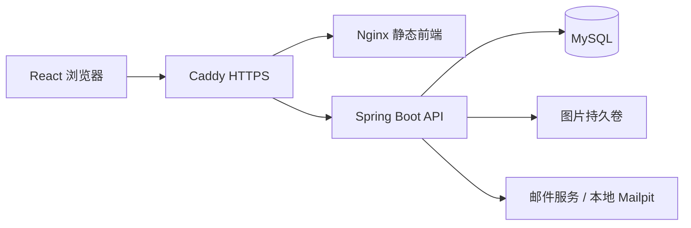
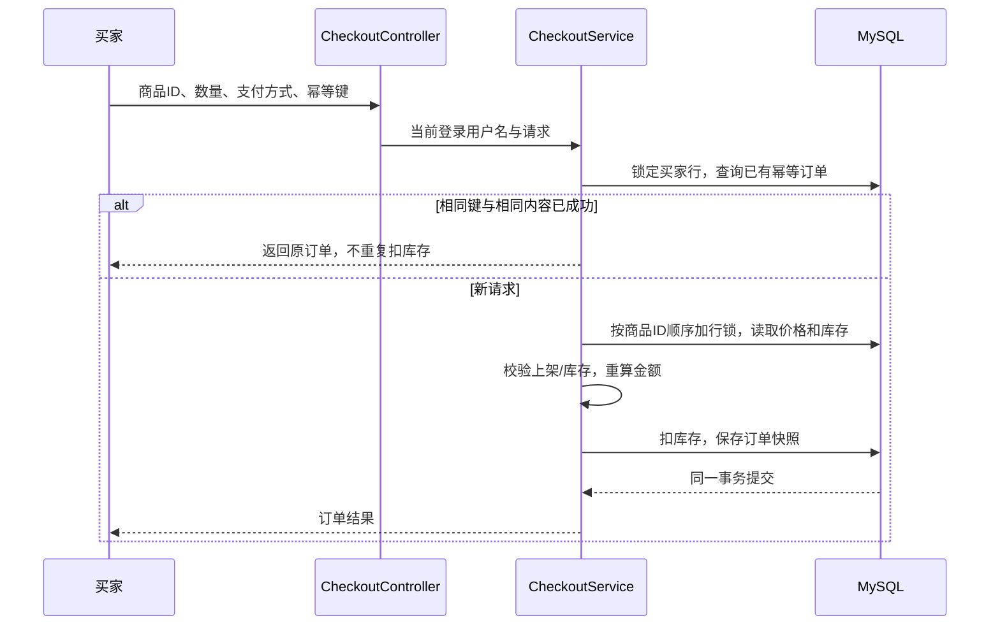

# 架构、商品查询与故障排查

本文描述仓库中的实际实现。当前已验证本地部署和恢复演练，不能据此声称已云端上线。

## 系统边界



生产配置在 `deploy/compose.yaml`，网关将 `/api/*` 去掉前缀后转发至后端；
MySQL、后端和管理端口不对宿主机发布。开发用根目录 Compose 与此独立。
代码入口：`SecurityConfig`、`JwtAuthenticationFilter`、`CatalogController`、
`CatalogService`、`CheckoutController`、`CheckoutService`。

## JWT 登录与权限

1. 登录接口验证用户名与 BCrypt 密码哈希；`JwtService` 签发包含用户名、用户 ID、角色、过期时间的签名 JWT。
2. 前端通过 `Authorization: Bearer <token>` 发送令牌。`JwtAuthenticationFilter` 验证签名和过期时间，建立 Spring Security 身份。
3. `SecurityConfig` 限制管理写接口；订单接口另用 `@PreAuthorize` 限制角色。浏览商品允许匿名访问。
4. `POST /checkout` 从服务端 Authentication 取得买家身份；`GET /checkout/me` 只按当前用户查询订单。客户端不能用请求中的用户名切换订单归属。
5. 无效令牌不会建立登录身份；受保护接口随后返回认证失败。JWT 角色来自签发时的声明，角色变更不会即时撤销已签发令牌，当前没有集中撤销列表。

找回密码使用有过期时间、单次使用的邮件令牌及数据库限流；用户响应 DTO 不包含密码哈希。
本地 Mailpit 验证邮件流程，正式邮件发送还需要配置 SMTP。

## 商品查询合同

商城改用 `GET /product/search`；生产浏览器地址为 `/api/product/search`。
现有 `GET /product` 暂保留给管理页和其他旧消费者，商城页不再下载全量商品。

| 参数 | 默认值 / 约束 | 含义 |
| --- | --- | --- |
| q | 空，最多 200 字符 | 名称、主分类、子分类、品牌、颜色、描述中任一字段包含关键词；忽略大小写 |
| mc / sc / br | 空或 All 表示不限制 | 主分类、子分类、品牌精确匹配 |
| min / max | 可独立省略 | 折后价的包含边界；非负，最多 12 位整数及 2 位小数；min 不得大于 max |
| sort | latest | latest / priceAsc / priceDesc，使用白名单 |
| page | 0，范围 0–100000 | 从零开始的页号 |
| size | 12，范围 1–100 | 每页数量，禁止无限加载 |

例如：

```text
/product/search?q=blue&mc=Clothes&sc=Shoes&br=Acme&min=10&max=40&sort=priceAsc&page=0&size=12
```

```json
{"content": [], "page": 0, "size": 12, "totalElements": 0, "totalPages": 0}
```

- `CatalogService` 用 JPA Specification 将所有条件以 AND 组合；关键词的六个字段以 OR 组合。固定排除未上架商品；缺货但仍上架的商品可展示，购买时另行校验库存。
- `%`、`_` 和转义符 `!` 都按普通搜索文本处理，用户输入不是 SQL。描述保持现有 MySQL longtext 结构，Java 使用 LONGVARCHAR 映射，以支持 SQL 小写函数搜索长文本。
- 数据库先过滤、排序，再限制页数；总数按同一条件计算。价格相同使用 ID 升序作为稳定次序，最新按 ID 降序。
- 查询是只读事务，DTO 转换在事务内完成；图片集合只针对本页商品加载。实体集合不参与 fetch join 分页。
- 空结果和越界页返回 200 与空 content；非法页号、价格、排序返回 400。筛选值按原样传入参数化查询。
- 商城 URL 保存已应用的筛选条件和页号。修改任一筛选重置第一页，其他条件保留；“Show All Products”清空所有条件。刷新、前进和后退可以复现查询。
- 页面展示加载、错误、重试、空结果、总条数与上一页/下一页；切换查询会取消旧请求，防止旧响应覆盖新结果。

当前使用包含匹配与 offset 分页，没有 Elasticsearch、全文索引或查询缓存。
包含匹配通常无法利用普通 B-tree 索引；深页仍需要扫描跳过行。
并发上架或删除时，跨页浏览不保证快照一致；数据规模增长后应基于实测查询计划考虑全文检索和游标分页。

## 下单、金额与并发



`CheckoutService.placeOrder` 的 `@Transactional(rollbackFor = Exception.class)`
覆盖读取、锁定、扣库存和订单保存。用户行锁串行化同一买家的首次请求与重试；
商品行的 PESSIMISTIC_WRITE 锁避免多个买家抢购时超卖；按 ID 加锁降低死锁风险。
数据库还对买家和幂等键设置唯一约束；相同键但不同购物内容返回 409。
保存失败或库存不足会回滚整个事务，不能留下只扣库存而没有订单的状态。

金额使用数据库中的 basePrice 与 discount 重新计算，转 BigDecimal 按两位小数 HALF_UP；
商品表价格目前仍为 Double，订单金额为 decimal/BigDecimal。不足 100 且大于 0 收取 4.99 运费，
达到 100 免运费；初始订单状态由后端设置，支付状态为 Pending。
订单保存当时的商品和价格快照；演示支付方式不表示接入真实支付网关。

## 测试与质量门禁

| 层级 | 验证目标 | 执行方式 |
| --- | --- | --- |
| 单元 / MVC / H2 | 参数错误、权限、业务分支、组合查询 | 后端 `mvnw.cmd clean verify` |
| Testcontainers MySQL | 真正 SQL 语义、约束、锁、并发与事务回滚、迁移 | 后端 `mvnw.cmd -Pmysql-it clean verify`，需要 Docker |
| React Testing Library | URL 查询组合、翻页、边界按钮、加载失败和重试 | 前端 `npm run coverage` |
| Playwright | 真实后端上的购买流程、管理员商品操作与访问控制 | 前端先 `npm run e2e:build`，再 `npm run test:e2e` |
| 部署恢复演练 | HTTPS、持久化、备份校验、新卷恢复、部分 DDL 失败回滚 | 根目录 `node scripts/recovery-drill.cjs` |

`CatalogSearchTest` 在 H2 执行，`CatalogSearchMySqlIT` 复用相同业务断言在真实 MySQL 执行；
不是给 mock 配置预设查询结果。所有五项 CI 为主分支必需检查，详见 `quality-gates.md`。
测试结果以当前运行报告为准，旧的成功结果不能代替修改后的验证。

## 部署与排错

完整命令、备份恢复和回滚的数据回退语义见 [生产部署与恢复](production-deployment.md)。
Jenkins 的本机流程不再自动执行 Seed Catalog；示例数据脚本只在明确需要本地初始化时手动运行。

| 现象 | 先检查 | 对应处理 |
| --- | --- | --- |
| 搜索 400 | 浏览器 Network 中的查询参数、响应 message | 检查页号、size、价格范围和 sort 白名单 |
| 搜索为空 | URL 中是否残留分类/品牌/价格、商品是否 active | 清空全部筛选再定位具体条件；不直接修改数据库掩盖问题 |
| 401 / 403 | JWT 是否过期、请求头、用户角色 | 重新登录；核对服务端权限，不能只隐藏前端按钮 |
| 下单 409 | 当前库存和幂等键是否被不同请求复用 | 刷新库存；同一次重试保留原键，新订单生成新键 |
| /healthz 失败 | Compose ps、后端就绪状态、MySQL 日志 | 确认数据库可认证连接，后端启动和迁移成功 |
| 图片丢失 | uploads 持久卷挂载和后端路径 | 使用同一快照恢复数据库与图片，核对校验和 |
| 发布失败 | 私有 `.state/failures` 诊断、Flyway 日志 | 先确认自动恢复结果；不能直接编辑已应用的 V1 或开启 ddl-auto=update |

诊断日志、环境文件和业务备份含敏感信息，不提交仓库，不上传为公开 CI 工件。
