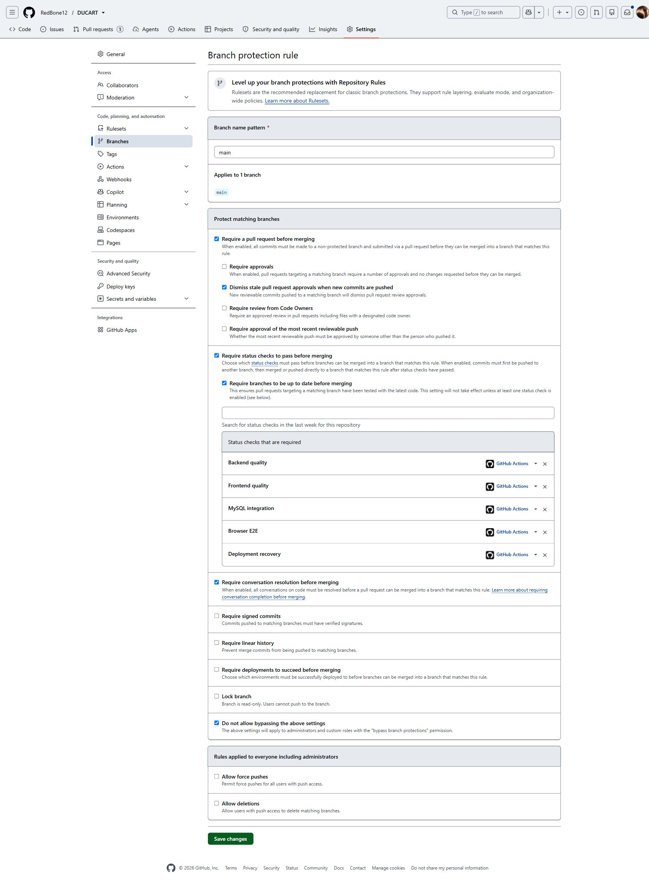

# Verified pull-request CI

The active PR pipeline is GitHub Actions, defined in
[quality.yml](../.github/workflows/quality.yml). Jenkins is an optional local
pipeline definition and is not the source of the required PR checks.

## Successful run

Verified on 29 October 2026:

- [PR #2](https://github.com/RedBone12/DUCART/pull/2) targets main from
  codex/catalog-search. This run tested commit
  `42c85b361abc37cfabd9db9ac8f0fb6654e70e7c` and its PR merge revision.
- [Quality run 40882524992](https://github.com/RedBone12/DUCART/actions/runs/40882524992)
  was triggered by `pull_request` and completed successfully.

| Required check | Result | Evidence |
| --- | --- | --- |
| Backend quality | Success | [Job](https://github.com/RedBone12/DUCART/actions/runs/40882524992/job/123477555921) |
| Frontend quality | Success | [Job](https://github.com/RedBone12/DUCART/actions/runs/40882524992/job/123477555140) |
| MySQL integration | Success | [Job](https://github.com/RedBone12/DUCART/actions/runs/40882524992/job/123477555198) |
| Browser E2E | Success | [Job](https://github.com/RedBone12/DUCART/actions/runs/40882524992/job/123477555288) |
| Deployment recovery | Success | [Job](https://github.com/RedBone12/DUCART/actions/runs/40882524992/job/123477554899) |

Deploy frontend was skipped because this is a PR run. A successful PR run does
not establish that Pages or a public backend was deployed. Reports are uploaded
as run artifacts with 14-day retention; logs and artifact availability depend on
GitHub retention settings. This is evidence for the named revision, not an
assertion that future commits pass.

## Main branch enforcement

The authenticated repository settings UI was inspected on 29 October 2026 after
the GitHub connector returned 403 for the branch-protection API. The existing
[main protection rule](https://github.com/RedBone12/DUCART/settings/branch_protection_rules/85375455)
showed all of the following enabled:

- Require a pull request before merging.
- Require the five status checks above, accepting results from GitHub Actions.
- Require branches to be up to date before merging.
- Require conversation resolution before merging.
- Do not allow bypassing these settings, including administrators.

Force pushes and branch deletion are disabled. Approval reviews are not required;
this permits a solo maintainer to inspect and merge a passing PR. The settings
were already in place and did not need weakening or replacement. They are
server-side settings, not configured by committing a workflow file. Recheck them
when changing required-check names or repository policy.

## Reviewing a new change

1. Push the change to a non-main branch and open or update its PR.
2. Confirm the Quality run is for the PR's latest head commit; an older green run
   does not validate a later push.
3. Inspect all five checks and any test/report artifacts. Keep job names stable
   so branch protection continues matching them.
4. Update a branch that is behind main and let checks rerun. Resolve review
   conversations before merging. Do not disable protection to merge a failure.
5. Merge only after review; main runs the checks again and publishes the verified
   frontend build after all five jobs succeed.

## Jenkins boundary

The checked-in Jenkinsfile alone does not prove a running Jenkins controller,
GitHub webhook, Multibranch PR discovery or published Jenkins build status.
GitHub Actions already supplies the required PR pipeline using native PR events.
A future Jenkins setup needs its own real execution and delivery evidence before
the project claims Jenkins integration. Public backend deployment, public
certificate issuance and off-host backup installation remain separate work.
